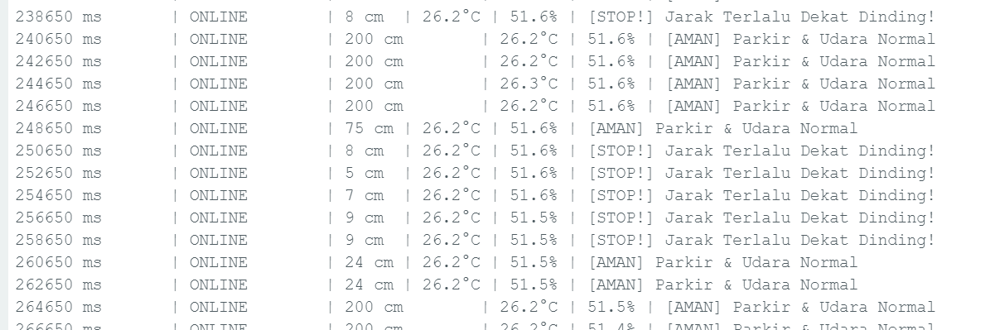

# 🚗 Sistem Monitoring Sirkulasi Udara & Sensor Parkir Garasi Pintar (*Smart Garage*)

Proyek ini dibuat untuk memenuhi tugas **Responsi 1 Praktikum Internet of Things (IoT)** dengan mengintegrasikan mikrokontroler ESP32, konektivitas Wi-Fi, sensor suhu & kelembapan (DHT22), serta sensor jarak ultrasonik (HC-SR04).

---

## 👤 Identitas Mahasiswa
* **Nama Lengkap:** Rosyida Hani Maryam
* **NIM:** 2411501005
* **Kelas:** A1 Semester 5
* **Mata Kuliah:** Praktikum Internet of Things (IoT)

---

## 📖 Deskripsi Proyek
Sistem **Smart Garage** ini dirancang sebagai prototipe otomatisasi dan pemantauan lingkungan pada garasi tertutup. Sistem ini memiliki dua fungsi utama dalam kehidupan sehari-hari:
1. **Sensor Parkir Otomatis:** Mendeteksi jarak bumper kendaraan terhadap dinding belakang garasi menggunakan sensor ultrasonik agar pengemudi tidak menabrak dinding.
2. **Pemantau Sirkulasi Udara:** Memantau suhu dan kelembapan udara di dalam garasi untuk mencegah ruangan menjadi terlalu pengap (akibat panas mesin kendaraan) atau terlalu lembap (yang dapat memicu karat pada bodi/komponen kendaraan).

---

## 🛠️ Deskripsi Perangkat Keras (*Hardware*)

| Komponen | Spesifikasi / Tipe | Fungsi dalam Sistem |
| :--- | :--- | :--- |
| **Mikrokontroler** | ESP32 DevKit V1 | Pusat pemrosesan data (*controller*) yang membaca masukan sensor, mengeksekusi logika ambang batas, mengendalikan aktuator LED, dan menghubungkan sistem ke jaringan Wi-Fi 2.4 GHz. |
| **Sensor 1** | DHT22 (AM2302) | Sensor digital *single-wire* yang mengukur suhu ruangan (°C) dan kelembapan relatif udara (%) untuk memantau kualitas sirkulasi udara garasi. |
| **Sensor 2** | Ultrasonic HC-SR04 | Sensor jarak non-kontak yang memancarkan gelombang ultrasonik (`TRIG`) dan menerima pantulannya (`ECHO`) untuk mengukur jarak kendaraan ke dinding (cm). |
| **Aktuator Indikator** | LED Built-in (GPIO 2) | Lampu indikator visual berwarna biru pada papan ESP32 yang menyala sebagai sinyal peringatan bahaya parkir atau sirkulasi udara buruk. |

---

## 🔌 Pemetaan Pinout (*Wiring Diagram*)

Berikut adalah koneksi kabel antara komponen sensor dengan pin pada papan **ESP32 DevKit V1**:

| Komponen | Pin Komponen | Pin ESP32 | Keterangan |
| :--- | :--- | :--- | :--- |
| **DHT22** | VCC (`+`) | `3V3` | Catu daya 3.3 Volt |
| **DHT22** | DATA (`out`) | `GPIO 4` (D4) | Jalur komunikasi data suhu & kelembapan |
| **DHT22** | GND (`-`) | `GND` | Ground |
| **HC-SR04** | VCC | `VIN` (5V) | Catu daya 5 Volt |
| **HC-SR04** | TRIG | `GPIO 5` (D5) | Pemicu gelombang ultrasonik |
| **HC-SR04** | ECHO | `GPIO 18` (D18) | Penerima pantulan gelombang ultrasonik |
| **HC-SR04** | GND | `GND` | Ground |
| **LED Indikator** | Internal LED | `GPIO 2` | Aktuator peringatan visual bawaan ESP32 |

---

## ⚙️ Alur Kerja Sistem IoT

1. **Inisialisasi (`setup`):**
   * Saat ESP32 dinyalakan, komunikasi serial diaktifkan pada *baud rate* `115200 bps` dan sensor DHT22 diinisialisasi.
   * Modul Wi-Fi diatur pada mode *Station* (`WIFI_STA`) untuk terhubung ke *Access Point* / *Hotspot* dan memperoleh alamat IP dinamis melalui DHCP (dilengkapi *timeout* 20 detik).
2. **Akuisisi Data Berkala (`loop`):**
   * Menggunakan timer *non-blocking* (`millis()`), sistem membaca data dari sensor setiap **2 detik (2000 ms)** agar pembacaan sensor DHT22 tetap stabil dan akurat.
   * Sistem juga melakukan pengecekan status Wi-Fi secara berkala; jika koneksi terputus (`OFFLINE`), ESP32 otomatis menjalankan `WiFi.reconnect()`.
3. **Pemrosesan Logika & Ambang Batas (*Thresholding*):**
   * **Kondisi Parkir Bahaya:** Jika jarak objek ke sensor HC-SR04 **$\le 20\text{ cm}$**, sistem menandai status `[STOP!] Jarak Terlalu Dekat Dinding!` dan menyalakan **LED Biru (`HIGH`)**.
   * **Kondisi Sirkulasi Buruk:** Jika suhu garasi **$> 32.0^\circ\text{C}$** atau kelembapan **$> 75.0\%$**, sistem menandai status `[SIRKULASI] Garasi Panas/Lembap!` dan menyalakan **LED Biru (`HIGH`)**.
   * **Kondisi Normal:** Jika jarak $> 20\text{ cm}$, suhu $\le 32.0^\circ\text{C}$, dan kelembapan $\le 75.0\%$, sistem berstatus `[AMAN]` dan mematikan **LED Biru (`LOW`)**.
4. **Telemetri Data:**
   * Seluruh hasil pembacaan (waktu sistem, status Wi-Fi, jarak dinding, suhu, kelembapan, dan status garasi) dikirimkan ke Serial Monitor dalam format tabel secara *real-time*.

---

## 💻 Struktur File Repositori

```text
├── smart_garage.ino          # Kode program utama Arduino C++ untuk ESP32
├── README.md                 # Dokumentasi lengkap proyek (halaman ini)
└── dokumentasi/              # Folder berisi foto rangkaian & screenshot Serial Monitor
    ├── rangkaian_fisik.jpg
    └── serial_monitor.png
```

---

## 📸 Dokumentasi & Hasil Pengujian

> *Catatan: Ganti nama file gambar di bawah ini sesuai dengan nama file foto/screenshot yang kamu unggah ke folder `dokumentasi/`.*

### 1. Rangkaian Perangkat Keras (ESP32 + DHT22 + HC-SR04)


### 2. Hasil Pengujian pada Serial Monitor


**Ringkasan Hasil Uji Validasi:**
* **Koneksi Wi-Fi:** Berhasil terhubung ke jaringan Wi-Fi dan mendapatkan alamat IP via DHCP.
* **Uji Sensor Parkir:** Ketika benda/tangan didekatkan pada jarak $\le 20\text{ cm}$ di depan sensor HC-SR04, LED biru pada ESP32 langsung menyala dan Serial Monitor menampilkan peringatan `[STOP!]`.
* **Uji Sirkulasi Udara:** Ketika sensor DHT22 diberi paparan suhu panas/kelembapan tinggi ($> 32^\circ\text{C}$ atau $> 75\%$), LED biru menyala dan status berubah menjadi `[SIRKULASI]`.